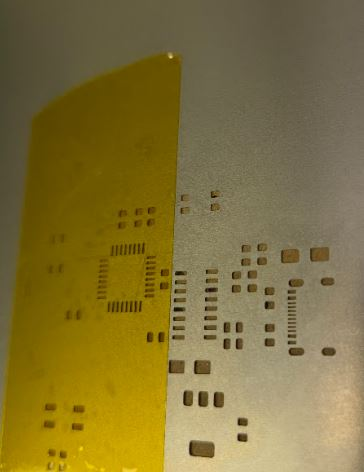

# Projet / Partie 1

## Partie 1:
- Assemblage avec pâte de la moitié du PCB (Surface-mount)

## Intro

Voici le projet final du cours de Diagnostic et circuits.

Le but ici est simple, réaliser un PCB fonctionnel avec un nombre de pièces limités, un seul PCB et passer par l'ensemble des moyens que vous avez appris durant cette session.

Un PCB non-fonctionnel ne veut pas dire un échec, mais beaucoup plus de test...

Pour la première étape, la classe sera divisé en deux, le but est de laisser l'ensemble des personnes prendre un temps raisonnable pour la pâte à souder. Votre stencil sera couvert à moitié, vous devez tout d'abord préparer une feuille avec votre demi-BOM avant de venir appliquer votre pâte.

Voici le stencil couvert:

Voici les composants qui seront souder avec la pâte.

Aller voir le BOM dans la section `pinout` (bom_arduino_nano) pour trouver les valeurs.

- C2, C3, C10
- DEL Tx, Rx (N'importe quelle couleur)
- U2, U3
- D2, D4
- R3, R4, R5, R7, R9, R10
- J2

Aller vous placer à une station de pâte quand vous êtes prêt.

**Ne pas préparer le BOM complet, si vous n'avez pas le temps de compléter, votre feuille (Et les composants) ne survivra pas 1 semaine dans un sac..**

## Placement

Nous avons des nouveaux types de composants dans ce circuits, aller regarder le schéma électrique dans `pinout` (arduino_nano).

#### Crystal (Through-hole)

Les crystaux ou oscillateurs sont des modules de quartz qui oscille à une fréquence défini. Ces 2 modèles sont respectivement de 12MHz et 16Mhz. Ils sont toujours accompagné de condensateurs de 22pF pour stabiliser l'horloge. À noter que ce sont des `crystaux`, des `oscillateurs` sont très similaire, mais les condensateurs sont à l'intérieur du module.

Il n'y a pas de polarité, mais attendez à la partie 3 pour le souder.

#### Diode simple (Surface-mount)

Il y a 2 diodes, utiliser le schéma électrique pour voir l'orientation. Comme les DELs/LEDs, ils ont une indicateur via une ligne, mais utiliser votre multimètre en mode `diode` pour voir l'orientation.

#### Point de diode

Il y a un pont de diode utiliser au niveau de l'entrée. Le but est de lire autant du analogique que de la tension numérique. Il est très important de bien le brancher. Regarder la datasheet `pont`. Le pont peut être placer en 2 orientations:

- ~~ <--> +-
- -+ <--> ~~

La meilleur façon est d'identifier + et -. Regarder dans quelle directions vont les diodes et avec votre multimètre en mode `diode`, vous pourrez voir comment le brancher.

**FAITES TRÈS ATTENTION, le point à l'envers peut court-circuité votre PCB en entier**

#### USB-C

Le port USB-C est quasiment impossible à faire à la souduire conventionnel, les pointes ne peuvent pas souder les pâtes sans brûler la section en plastique, bien suivre les instructions de l'enseignant pour ce composant en particulier.

Voici aussi un visuel:

- Prendre le composant avec une paire de pince (Dans le trou du connecteur)

- Déposer les pates arrière Trhough-Hole en premier

- Descendre le restant du composant

- Lâcher le tout

#### Bornier à vis
Les borniers sont assez gros, assurez-vous d'aligner le tout pour avoir des connecteurs droits.

#### AtMega, Régulateur et CH340
Les nouveaux modules de type `U` sont plus nombreux que le compteur. Chacun est essentiel au fonctionnement, mais voici le rôle de chacun.

- AtMega: Il s'agit d'un AtMega328P, le microcontrôlleur utilisé dans les Arduino Nano, la documentation se trouve dans datasheet
- CH340G: Il s'agit du module en charge de la communication (et programmation) du AtMega. Il est essentiel pour programmer, mais pour pour executer le programme.
- Régulateur: Essentiel si on utilise une alimentation externe autre que le USB-C, il fourni jusqu'à 800mA.

**Toujours bien vérifier pour la pin 1 sur les formats TQFN(Atmega) et SOIC(CH340G) est bien suivi, ça peut être une indication comme un cercle ou même une barre**

# Évaluation

> $\color{darkred}{\text{À VÉRIFIER}}$ **Eval**
>
> Montrer à l'enseignant la soudure avec pâte (Aucun test requis)
> 
> 

> $\color{darkgreen}{\text{À NOTER}}$ **Partie 1**
>
> Prendre une photo de votre PCB à moitié rempli et ajouter la photo dans le rapport
> 
> 