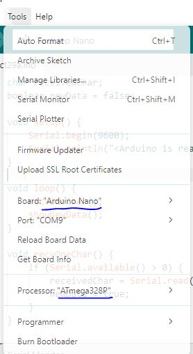

# Projet / Partie 3


## Partie 3:
- Partie Through-hole essentielle (1/3)

## Intro

Pour la troisième partie, nous allons placer l'ensemble des composants pour un minimum de test, soit sur le AtMega et CH340G seulement.

> $\color{gray}{\text{MANIPULATION}}$ **Through-hole Part 1**
>
> Souder J1, Y1 et Y2
>


> $\color{darkred}{\text{À VÉRIFIER}}$ **Eval et bootloader**
>
> Montrer à l'enseignant la soudure à son bureau et ce dernier pourra installer le bootloader de Atmel via votre port J1.
> 

Le but est de placer un programme dans votre AtMega pour le reprogrammer ET l'utiliser avec la connexion UART0 (Et donc avec le CH340G, le USB-C)

Une fois le bootloader graver sur votre système, ouvrer votre document rapport.docx et prendre les mesures avec les differents programmes. 

**Utiliser le Arduino IDE pour placer les programmes à l'intérieur, regarder la zone en bas pour voir l'ensemble des manipulations.**

Configuration au branchement du Arduino IDE:



## Programme utile pour la test de rapport

#### UART testing
```
char receivedChar;
boolean newData = false;

void setup() {
    Serial.begin(9600);
    Serial.println("<Arduino is ready>");
}

void loop() {
    recvOneChar();
    showNewData();
}

void recvOneChar() {
    if (Serial.available() > 0) {
        receivedChar = Serial.read();
        newData = true;
    }
}

void showNewData() {
    if (newData == true) {
        Serial.print(receivedChar);
        newData = false;
    }
}
```

#### Blink
(trouver D13 à l'aide du schéma électrique)
```
void setup() {
  // initialize digital pin LED_BUILTIN as an output.
  pinMode(LED_BUILTIN, OUTPUT);
}

// the loop function runs over and over again forever
void loop() {
  digitalWrite(LED_BUILTIN, HIGH);  // change state of the LED by setting the pin to the HIGH voltage level
  delay(100);                      
  digitalWrite(LED_BUILTIN, LOW);   // change state of the LED by setting the pin to the LOW voltage level
  delay(100);                      
}
```

#### SD Card testing (SPI)
```
/*
  SD card test

  This example shows how use the utility libraries on which the'
  SD library is based in order to get info about your SD card.
  Very useful for testing a card when you're not sure whether its working or not.

  The circuit:
    SD card attached to SPI bus as follows:
 ** MOSI - pin 11 on Arduino Uno/Duemilanove/Diecimila
 ** MISO - pin 12 on Arduino Uno/Duemilanove/Diecimila
 ** CLK - pin 13 on Arduino Uno/Duemilanove/Diecimila
 ** CS - depends on your SD card shield or module.
 		Pin 4 used here for consistency with other Arduino examples


  created  28 Mar 2011
  by Limor Fried
  modified 9 Apr 2012
  by Tom Igoe
*/
// include the SD library:
#include <SPI.h>
#include <SD.h>

// set up variables using the SD utility library functions:
Sd2Card card;
SdVolume volume;
SdFile root;

// change this to match your SD shield or module;
// Arduino Ethernet shield: pin 4
// Adafruit SD shields and modules: pin 10
// Sparkfun SD shield: pin 8
// MKRZero SD: SDCARD_SS_PIN
const int chipSelect = 10;

void setup() {
  // Open serial communications and wait for port to open:
  Serial.begin(9600);
  while (!Serial) {
    ; // wait for serial port to connect. Needed for native USB port only
  }


  Serial.print("\nInitializing SD card...");

  // we'll use the initialization code from the utility libraries
  // since we're just testing if the card is working!
  if (!card.init(SPI_HALF_SPEED, chipSelect)) {
    Serial.println("initialization failed. Things to check:");
    Serial.println("* is a card inserted?");
    Serial.println("* is your wiring correct?");
    Serial.println("* did you change the chipSelect pin to match your shield or module?");
    while (1);
  } else {
    Serial.println("Wiring is correct and a card is present.");
  }

  // print the type of card
  Serial.println();
  Serial.print("Card type:         ");
  switch (card.type()) {
    case SD_CARD_TYPE_SD1:
      Serial.println("SD1");
      break;
    case SD_CARD_TYPE_SD2:
      Serial.println("SD2");
      break;
    case SD_CARD_TYPE_SDHC:
      Serial.println("SDHC");
      break;
    default:
      Serial.println("Unknown");
  }

  // Now we will try to open the 'volume'/'partition' - it should be FAT16 or FAT32
  if (!volume.init(card)) {
    Serial.println("Could not find FAT16/FAT32 partition.\nMake sure you've formatted the card");
    while (1);
  }

  Serial.print("Clusters:          ");
  Serial.println(volume.clusterCount());
  Serial.print("Blocks x Cluster:  ");
  Serial.println(volume.blocksPerCluster());

  Serial.print("Total Blocks:      ");
  Serial.println(volume.blocksPerCluster() * volume.clusterCount());
  Serial.println();

  // print the type and size of the first FAT-type volume
  uint32_t volumesize;
  Serial.print("Volume type is:    FAT");
  Serial.println(volume.fatType(), DEC);

  volumesize = volume.blocksPerCluster();    // clusters are collections of blocks
  volumesize *= volume.clusterCount();       // we'll have a lot of clusters
  volumesize /= 2;                           // SD card blocks are always 512 bytes (2 blocks are 1KB)
  Serial.print("Volume size (Kb):  ");
  Serial.println(volumesize);
  Serial.print("Volume size (Mb):  ");
  volumesize /= 1024;
  Serial.println(volumesize);
  Serial.print("Volume size (Gb):  ");
  Serial.println((float)volumesize / 1024.0);

  Serial.println("\nFiles found on the card (name, date and size in bytes): ");
  root.openRoot(volume);

  // list all files in the card with date and size
  root.ls(LS_R | LS_DATE | LS_SIZE);
}

void loop(void) {
}
```

Branchement du lecture de carte SD:

```
// 10 <-> CS
// (Sur le header)
// MOSI <-> DI 
// MISO <-> DO
// CLK <-> SCK
// GND <-> GND
// 5V <-> 5V
```

#### Lecture analogique
```
void setup() {
  // initialize serial communication at 9600 bits per second:
  Serial.begin(9600);
}

// the loop routine runs over and over again forever:
void loop() {
  // read the input on analog pin 0:
  int sensorValue = analogRead(A0);
  // Convert the analog reading (which goes from 0 - 1023) to a voltage (0 - 5V):
  float voltage = sensorValue * (5.0 / 1023.0);
  // print out the value you read:
  Serial.println(voltage);
}
```

> $\color{darkgreen}{\text{À NOTER}}$ **Partie 3**
>
> Remplir le document avec les prises d'oscilloscope ET les sorties sérielle
> 
> 

> $\color{darkred}{\text{À VÉRIFIER}}$ **Faire valider les étapes suivantes en classe**
>
> Valider avec l'enseignant:
> - Partie 3 - UART Testing
> - Partie 3 - Blink
> - Partie 3 - SD Card
> - Modifier blink pour tester l'ensemble des pins, faite juste un programme qui allume l'ensemble des DELs/LEDs d'un coup
> - Utiliser et modifier le code dans `Lecture Analogique` pour tester l'ensemble des pins analogiques. Brancher un potentiometre avec la configuration suivantes:
> 
> // Pin 1 <-> VCC
>
> // Pin 2 <-> A0...7
>
> // Pin 3 <-> GND
>
> 